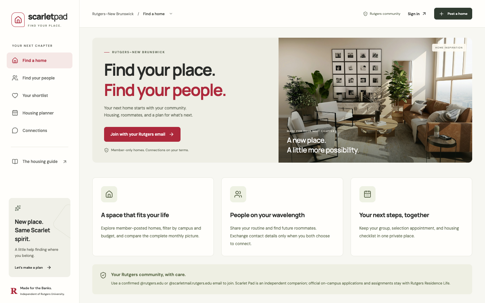
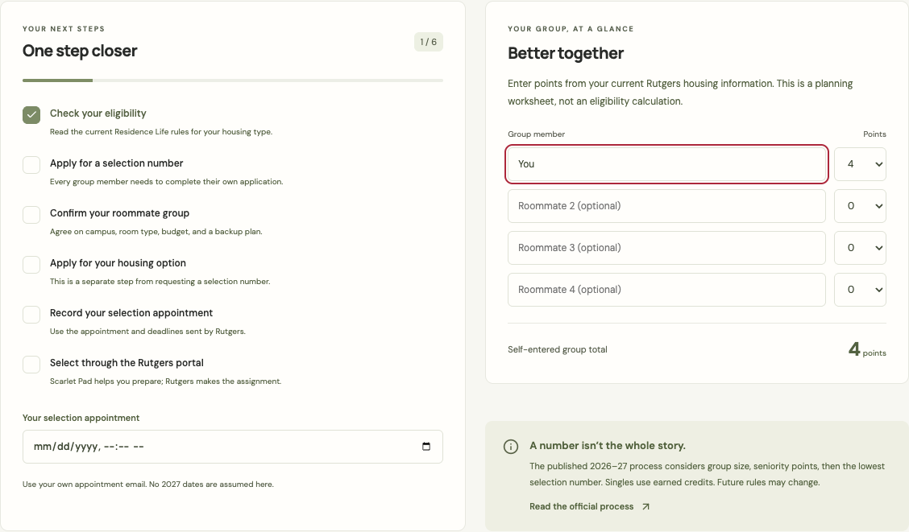
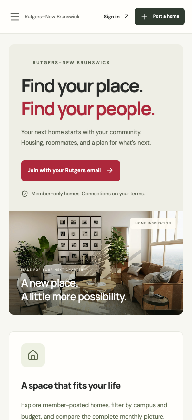

<div align="center">
  <h1>Scarlet Pad</h1>
  <p><strong>Find your place. Find your people.</strong></p>
  <p>A housing and roommate companion I built for the Rutgers–New Brunswick community.</p>
  <p><a href="https://scarlet-pad-ikshwaku.fabled-crumb-5773.chatgpt.site"><strong>Open Scarlet Pad ↗</strong></a> · <a href="#run-it-locally">Run locally</a> · <a href="docs/VERIFICATION.md">Verification</a></p>
</div>



I'm **Ikshwaku Vanani**, and I built Scarlet Pad to make finding a place around Rutgers feel less scattered. I wanted one place to explore housing, compare the real monthly costs, meet potential roommates, and keep track of the on-campus selection process.

I designed the app around the decisions I would want to make before calling somewhere home: what I can afford, where I want to live, who I want to live with, and what I need to do next.

## A closer look

<table>
  <tr>
    <td width="68%"></td>
    <td width="32%"></td>
  </tr>
</table>

_These are cropped interface captures. Planner values are examples; they are not official housing advice or records from real students._

## What I built

- **Housing discovery:** campus, rent, bedroom, lease and amenity filters, sorting, and an OpenStreetMap view with optional neighborhood pins.
- **A practical shortlist:** saved homes and side-by-side comparisons for up to three places, including estimated utilities.
- **Private listing photos:** JPEG, PNG and WebP uploads with size limits, member access controls and short-lived image URLs.
- **Roommate discovery:** opt-in profiles with budget, campus, schedule and shared-space preferences. I can pause my profile without deleting it.
- **Connections with consent:** requests and an inbox, with Rutgers email contact details shared only after acceptance.
- **An on-campus planner:** a private checklist, group worksheet, selection appointment and text export.
- **Rutgers email membership:** passwordless sign-in and server-enforced membership at `rutgers.edu` and `scarletmail.rutgers.edu`.

I keep member homes and profiles behind sign-in. The live app does not fill an empty community with fictional listings. For local design work, running without Supabase configuration opens an explicitly labeled sample board.

## How I built it

| Layer     | Stack                                                                                         |
| --------- | --------------------------------------------------------------------------------------------- |
| Interface | React, TypeScript, Vite, Radix Dialog, Lucide, custom responsive CSS                          |
| Identity  | Supabase Auth with confirmed Rutgers email and a signup allowlist                             |
| Data      | Supabase Postgres, row-level security and consent-aware contact access                        |
| Photos    | Private Supabase Storage with file-size and MIME restrictions                                 |
| Maps      | Leaflet and OpenStreetMap                                                                     |
| Checks    | Strict TypeScript, Node tests, PostgreSQL/PGlite, live integration checks, Playwright and axe |

I use the canonical Auth record for membership checks rather than editable profile metadata. Shortlists and plans belong to their owners, hidden roommate profiles stay hidden, and an unrelated member cannot read someone else's connection request. There is no service-role key in the browser bundle.

## Run it locally

I use Node 22.18+ and npm.

```sh
npm ci
npm run dev
```

Development mode opens a local sample board by default. To work against an owned Supabase project, copy `.env.example` to `.env.local` and set its browser URL and publishable key.

```sh
npm test
npm run build
npm run preview
```

The production build uses the browser-safe project configuration in `.env.production`. That file contains a **publishable** key, which is intentionally public; it is not an administrative credential. Database and Storage policies enforce access independently of the key. I keep all private credentials out of Git.

## Deploy the repository

The build command is `npm run build`, and the static output is `dist/`. I include route indexes and SPA fallback configuration for deep links. Vercel and Netlify configuration files are included, so the same repository can be imported there without changing application code.

The current live app is connected to Supabase project `wgsqvddfdrebmajgjklp`. I track its schema under `supabase/migrations` and its Auth URLs in `supabase/config.toml`. When deploying to a different origin, I update the Auth Site URL and allowlist that origin's `/auth/callback` URL before testing sign-in.

A new Supabase project needs the tracked migrations applied in order, email confirmation enabled, the signup hook configured, and a production SMTP sender. Supabase's built-in sender is restricted to project-team addresses. See [deployment details](docs/LAUNCH.md) for the current email-delivery requirement and exact setup.

For an explicit integration check against the owned live project, I use:

```sh
node scripts/live-smoke.mjs
```

That script requires an authenticated Supabase CLI. It creates temporary synthetic accounts, exercises Auth/PostgREST/Storage and privacy rules, and removes its test records. It never logs an admin key or sends verification emails.

## What I keep separate

Scarlet Pad is my independent project, not an official Rutgers service. Rutgers Residence Life still manages on-campus applications and room assignments. My planner helps organize preparation; it does not promise a selection outcome.

Confirming a Rutgers email proves control of that address, not current enrollment or the legitimacy of a property. I don't label homes as verified, process rent payments, or manufacture availability. Official NetID access would require an institution-approved integration and trusted affiliation checks.

I keep the [project notes](docs/PROJECT_MEMORY.md), [launch details](docs/LAUNCH.md), [verification results](docs/VERIFICATION.md) and [image sources](docs/ASSETS.md) alongside the code.

---

Built by **Ikshwaku Vanani**.
